# AI 根据电影原片还原出拍摄现场

只给 AI 一段成片，没有分镜，也没有现场照，让它倒推出拍摄现场：机位在哪、怎么动，人怎么走，光从哪来。然后在 Blender 里把现场搭回去，再用同样的机位“重拍”一遍，和原片逐帧对照。

这个仓库收录了两个可复用的 Claude skill，对应两种还原思路：

| | Skill | 一句话 | 案例 |
|---|---|---|---|
| 🎥 **长镜头还原** | [`film-set-reconstruction`](skills/film-set-reconstruction/SKILL.md) | 一台摄影机走完一条街，逐帧还原它的运动轨迹 | 《大事件》（2004）开场一镜到底，6′47″ |
| 🎬 **多镜头群戏还原** | [`multishot-scene-set-reconstruction`](skills/multishot-scene-set-reconstruction/SKILL.md) | 把剪碎的镜头拼回一个房间，画出全部机位和灯位 | 《周处除三害》（2023）灵修堂，7′43″、138 个镜头 |

<table>
<tr>
<td width="50%" align="center">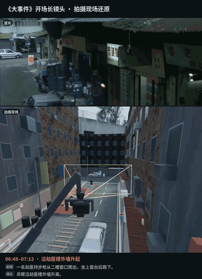</td>
<td width="50%" align="center">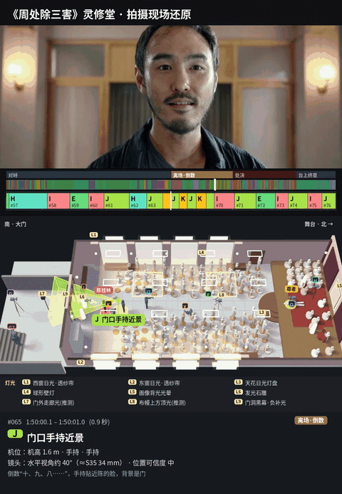</td>
</tr>
<tr>
<td align="center"><b>长镜头</b>：上为原片，下为还原的拍摄现场<br>9768 帧，每一帧的机位都和原片对得上</td>
<td align="center"><b>多镜头</b>：成片切到哪个镜头，俯视图里对应的机位就亮起来<br>138 个镜头，只来自 25 个机位</td>
</tr>
</table>

两个项目全程只用了 Claude：它读片源、写代码、跑计算，再通过 Blender MCP 插件在 Blender 里建模、渲染。人只做两件事：提要求，挑毛病。

**目录**

- [两种思路，分别适合什么样的片段](#两种思路分别适合什么样的片段)
- [长镜头还原：一台摄影机，走完一条街](#长镜头还原一台摄影机走完一条街)
- [多镜头还原：138 个镜头，拼回一个房间](#多镜头还原138-个镜头拼回一个房间)
- [怎么使用这两个 skill](#怎么使用这两个-skill)
- [仓库结构](#仓库结构)
- [几点体会](#几点体会)
- [English summary](#english-summary)

---

## 两种思路，分别适合什么样的片段

两种思路要回答的问题不一样。

- **长镜头**问的是：**摄影机每一帧在哪，怎么走？** 还原的是一条连续的机位轨迹，人物也要逐个按原片走位摆回去。
- **多镜头**问的是：**每个镜头是哪台机拍的，机位和灯怎么布？** 还原的是一张固定的俯视现场图，成片放到哪个镜头，图上就亮哪台机。

### 怎么选

**先数剪辑点。**

- 一个镜头持续一两分钟以上，摄影机一直在动 → 长镜头还原。
- 很多短镜头切来切去，但空间一直是同一个 → 多镜头还原。
- 一场戏两者都有，比如群戏中间夹着一段长镜头 → 用多镜头还原画出整场戏的俯视图，再对其中那段长镜头单独跑长镜头流程。

### 对比

| | 长镜头还原 | 多镜头群戏还原 |
|---|---|---|
| **适合的片段** | 一镜到底、剪辑很少；摄影机连续运动（吊臂、轨道、斯坦尼康、手持跟拍、车拍）；空间是摄影机一路“走”出来的：街道、楼道、穿过好几个房间、室内外来回 | 多机位剪辑的一场戏；空间相对固定：房间、礼堂、餐厅、法庭、审讯室、车厢、天台；镜头多也没关系，几十到上百个都行 |
| **典型场景** | 街头调度、跟着人物穿行的长镜头、“伪一镜到底”（隐藏剪辑点分段处理） | 对峙、群戏、饭局、审讯、会议、枪战、舞台演出 |
| **画面里需要有** | 足够多不动的结构（楼面、门窗、车、家具）给 SfM 抓特征点；站着的人或停着的车，用来定比例 | 能当尺子的固定物（门框、窗、空调、舞台、桌椅、画像）；最好有全景或大全景交代空间 |
| **还原单位** | 一条连续的机位轨迹 `cam(f)`，单位米 | 机位方案（setup），A、B、C… 编号 |
| **核心方法** | 全片 SfM + 消失点定焦距和重力 + 人和车的尺寸定比例 + 手工关键帧补洞 | 剪辑点检测 + 按构图归并机位 + 房间参数化联合 BA + 逐机位 PnP |
| **人物** | 逐个识别、追踪、定身份，按原片走位摆放 | 群演按座位批量摆，只给主角走位 |
| **灯光** | 不是重点（外景用阴天 HDRI） | 输出灯光表，每盏灯写明证据和可信度 |
| **成片版式** | 上：摄影机身后视角（带吊臂、取景框）｜中：原片｜下：剧情和镜头说明 | 上：原片｜中：滚动的机位时间轴｜下：俯视现场 + 机位说明 |
| **工作量** | 大：SfM 会断成好几段，人物要逐个摆，通常审片 2–3 轮，整片渲染约 3 小时 | 中：机位归并和读标定点主要靠人眼，1–2 小时；从丢进片源到第一版视频约两个小时 |

### 不太适合，或者要打折扣的片段

- **大面积暗部、烟雾、水面、纯色背景**：SfM 抓不到特征点，长镜头流程会大量依赖手工关键帧。
- **只有特写、看不到环境**：空间信息太少，机位只能按“离人多远、多高、朝哪”推断，可信度低。
- **大量 CG 或绿幕合成**：画面里的空间本身是合成的，倒推出的“现场”并不存在。
- **空间不停切换的段落**（追逐、蒙太奇）：画不出一张固定的俯视图，多镜头流程不适用；只能拆成几个空间分别做。
- **频繁变焦的长镜头**：焦距不再固定，要逐段求焦距，工作量明显增加。
- **方案是边拍边“长”出来的导演**（比如王家卫）：机位和光能倒推出来，但那是替他事后整理的结果，不是当时的“方案”。拿来当教材时要说清楚。

### 两种思路共用的三个关键

1. **先找尺子。** 成片里没有尺寸，比例全靠已知大小的东西：人的身高（约 1.70–1.80 m）、车身（约 4.3 × 1.7 × 1.45 m）、门框、空调柜。
2. **线框投回原片，几秒验收一轮。** 不用等 Blender 渲染：把楼面、车、门框的线框直接投到原片帧上，对不上就改机位，重跑。
3. **同机位渲染，并排对照。** 在 3D 场景里放一台和原片同位置、同焦距的“验收摄影机”，渲染出来和原片并排看。看不到证据的地方标“推断”或“推测”，不把推断说成事实。

---

## 长镜头还原：一台摄影机，走完一条街

> 案例：杜琪峰《大事件》（2004）开场，原片 01:20.8–08:07.7，一镜到底，407 秒、9768 帧。
> 完整方法见 [`skills/film-set-reconstruction/SKILL.md`](skills/film-set-reconstruction/SKILL.md)，每一步的命令和参数见 [`references/pipeline.md`](skills/film-set-reconstruction/references/pipeline.md)。

### Step 1 · 认出每一个人、每一辆车

先切出镜头、去黑边，每 3 帧抽一张图。用 YOLOX 逐帧框出人和车（整帧跑一遍，再切成 3 块瓦片跑一遍，远处的小人物也能框到），再用 MediaPipe 标出骨骼关节。

然后在图像里把框连成短轨迹，原则是**宁可断开，也不要把两个人串成一个**。最后由 Claude 看截图，给每条轨迹标身份：劫匪、便衣、巡警、路人。自动重识别在换角度、被遮挡时很容易串错，所以这一步交给“看图”。

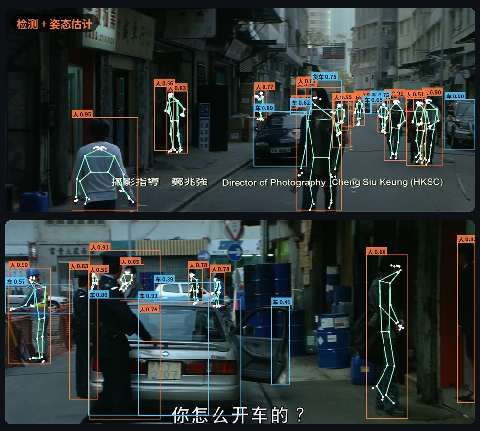

### Step 2 · 算出摄影机每一帧在哪

这是最难、也最有意思的一步。

一开始 AI 是凭画面“目测”机位，误差好几米。后来改用 **SfM（运动恢复结构）**：从 3000 多张画面里，反算出约 25 万个三维点，以及每一帧摄影机的位置和朝向。

- **焦距**：用两个互相垂直的消失点求，长镜头通常是定焦，《大事件》算出水平视角约 42°。
- **重力方向**：用每帧的竖直消失点，把模型“扶正”。
- **比例**：用站着的人（脚在地上，头顶在脚正上方 1.70 m）和停着的车，把 SfM 的单位校成米。
- **断段**：暗处、快速甩镜、穿窗进屋的地方 SfM 一定会断。每一段单独对齐到世界坐标，中间断掉的部分用门框、窗台、车身角点手工解出关键帧，再插值连起来。

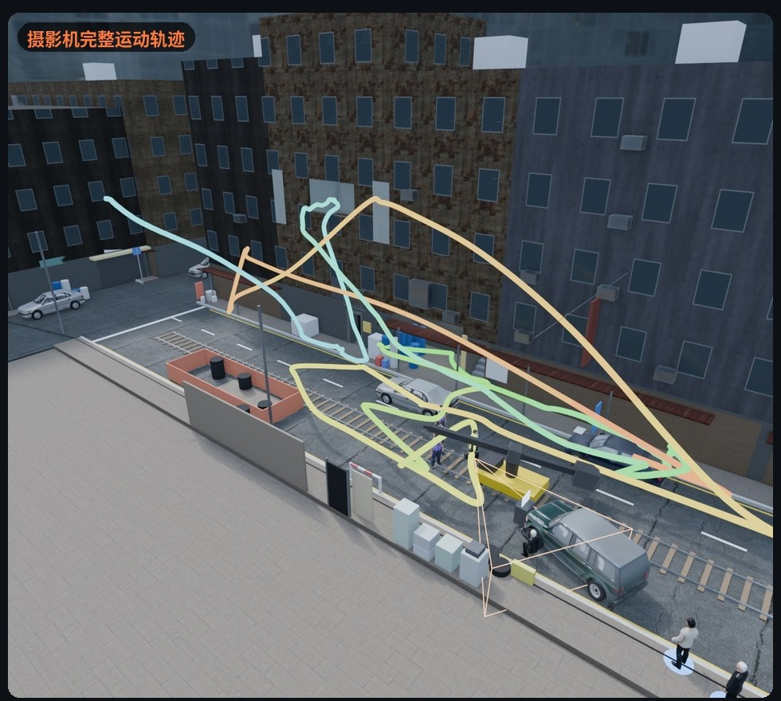

### Step 3 · 搭街

先用接触印样（每 2 秒一张）把摄影机经过的东西按顺序列成**勘景清单**：每栋楼、门洞、窗口、楼梯、店铺、修路区、车辆、路口形状。然后用一个 Python 脚本在 Blender 里生成整条街，改完重跑就行。

摄影机会钻进去的地方（车内、劫匪的房间、楼梯间）要建出内部。

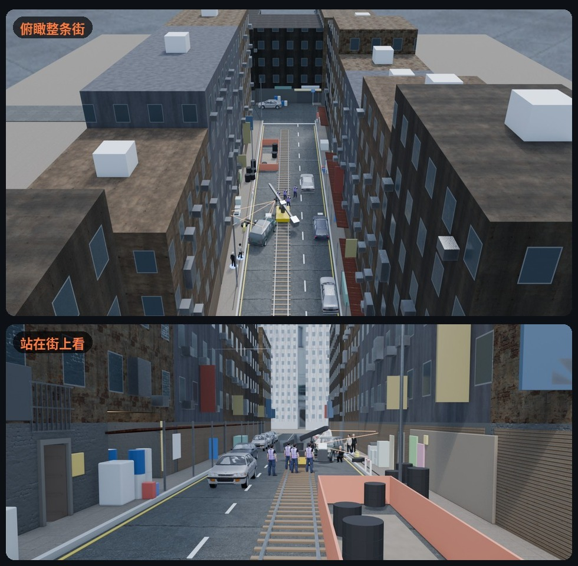

### Step 4 · 把每个人摆回地面

从机位沿着脚点像素打一条射线，求它和地面的交点，就是这个人此刻站的位置。脚被画面切掉时改用头顶高度反推距离；算到墙里或车里的点，沿视线滑回墙面或车身边上。朝向优先用 3D 骨骼的肩、髋方向，没有就用运动方向。

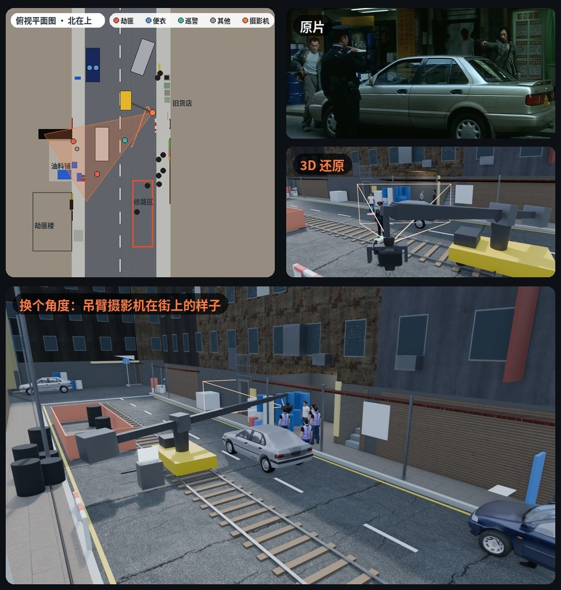

### Step 5 · 同机位对照，逐页审片

在 Blender 里放一台和原片同位置、同焦距的验收摄影机，每 3 秒抽一帧，和原片并排排成 PDF，一共 136 组。人逐页挑错，按“第几页第几帧”反馈，AI 逐条落实到改机位、补道具、改走位或改朝向。

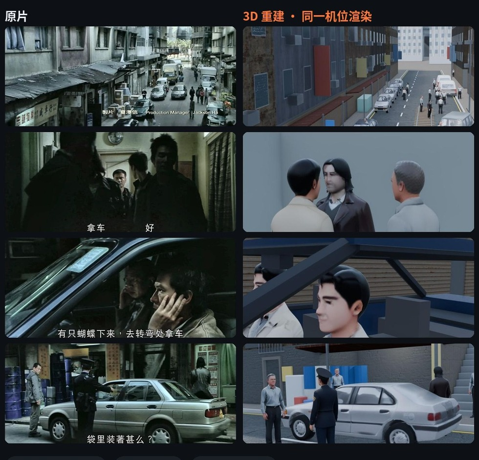

### Step 6 · 按反馈迭代

三轮审片里，大半问题是“漏了东西”：门、楼梯、身后的门、窗口里要探出的人、整个丁字路口。

还有个好笑的 bug：镜头钻进车里时，AI 把整辆车藏了起来，车里坐着的两个便衣也跟着“消失”。后来它给车补上了内饰：机位在车里时隐藏车壳、只显示车内。

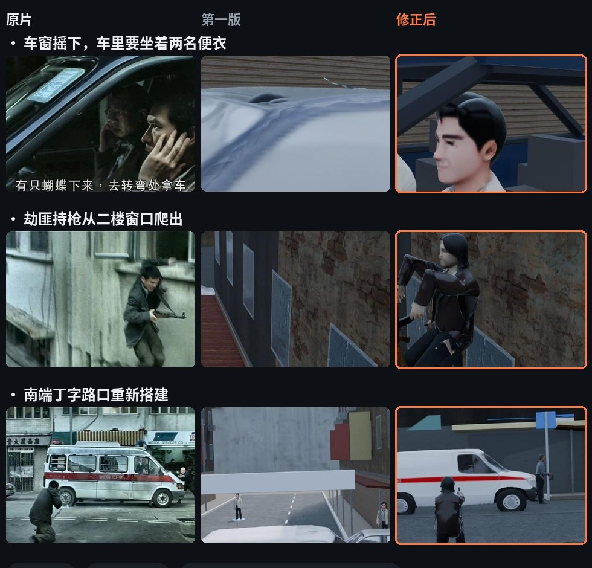

### Step 7 · 从摄影机身后看，渲染成片

最后换一个视角，站在摄影机身后看：吊臂、轨道车、取景框都在画面里。EEVEE 渲染 9768 帧约 3 小时，再和原片、字幕条分段合成。

<table>
<tr>
<td width="58%">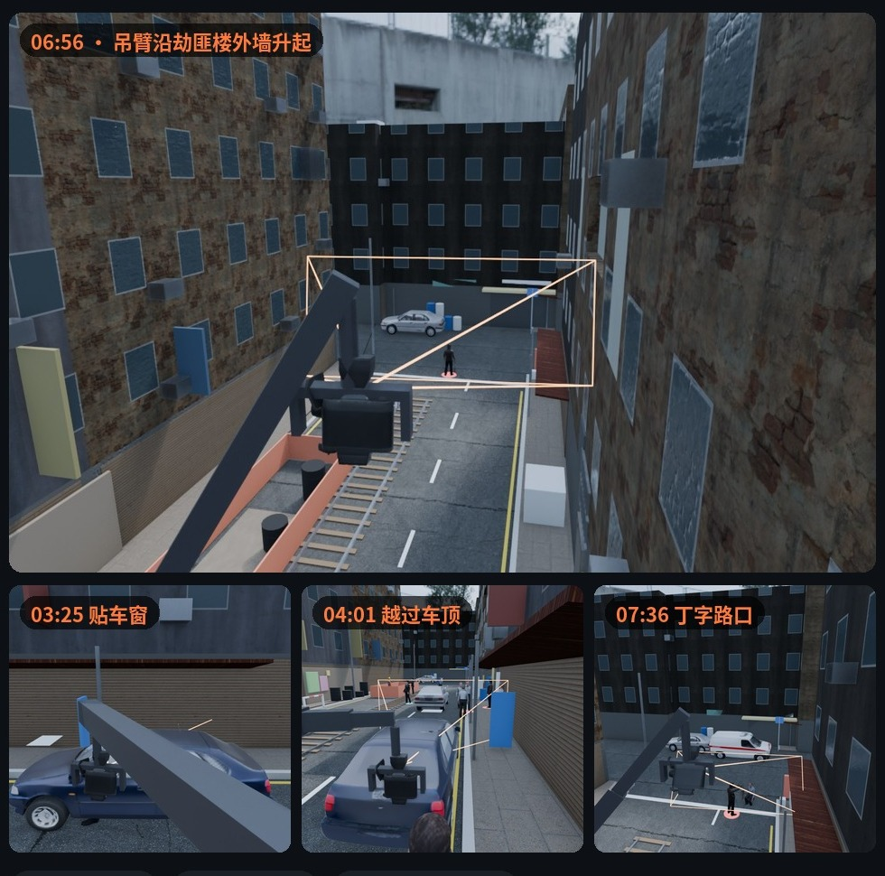</td>
<td width="42%">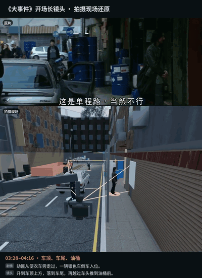</td>
</tr>
</table>

成片：1080×1488，上层是拍摄现场，中层是原片，底部每个段落一句剧情、一句镜头运动。

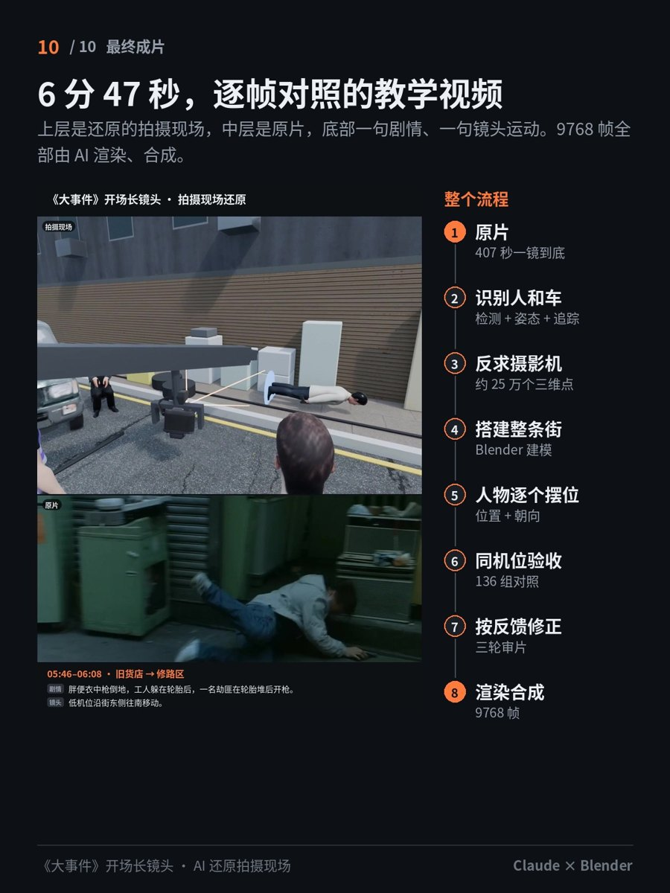

---

## 多镜头还原：138 个镜头，拼回一个房间

> 案例：《周处除三害》（2023）灵修堂，原片 1:45:06.6–1:52:50.1，7′43″，138 个镜头 → 25 个机位方案、9 组光源。
> 完整方法见 [`skills/multishot-scene-set-reconstruction/SKILL.md`](skills/multishot-scene-set-reconstruction/SKILL.md)。

长镜头是跟着一台机走，多镜头反过来：要把一堆碎片拼回同一个空间。

先说清楚一个上限：**成片里分不出“几台机同时拍”和“一台机换位置分几次拍”**。所以还原的单位是“机位方案”，只有在有证据时才注明“推断为双机同拍”。

### Step 1 · 拆镜头

前后两帧突然变化的地方就是剪辑点。但枪口闪光也会让画面突变，所以 AI 会看几帧之后画面会不会“弹回来”：弹回来的是闪光，不是剪辑。这场屠杀戏一共排除了 22 处枪口闪光，逐页看过镜头表后又合并了 12 处误切，最后得到 138 个镜头。

再用光流统计每个镜头的运动：变焦、手持抖动、视差，分辨出推拉、手持、轨道和固定机位。

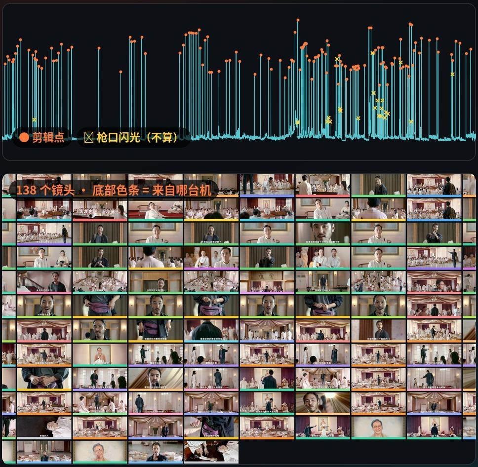

### Step 2 · 归机位

背景构图一样（同一面墙、同一组物体的相对位置）、景别接近，就是同一个机位；同一机位换焦段也还算一个。138 个镜头归成 25 个机位。

SfM 也提供了硬证据：同机位的镜头，反算出的摄影机中心几乎重合。

结论很有意思：近一半的出画时长，来自两台背靠背架在人群中间的长焦摄影机，一台朝门，一台朝台。

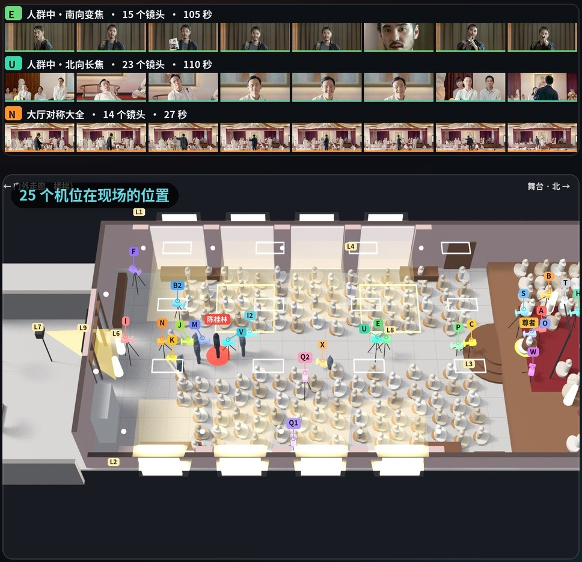

### Step 3 · 拿画面当尺子

没有图纸，就拿不会动的东西当尺子：门框四角、空调柜、画像、舞台边、侧门，再加上主角约 1.8 米的身高。给每个点起名字，坐标写成房间尺寸的函数，在多个镜头里一起解，解出礼堂约 10.4 × 22.6 米。

AI 还查到了协拍资料：这里是台北旧士林分局的礼堂实景，剧组在地上铺了轨道。

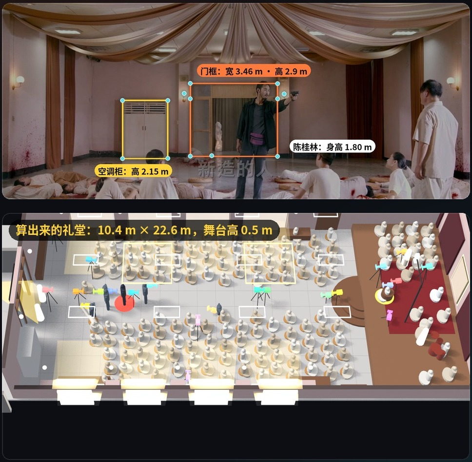

### Step 4 · 把房间“套”回每个镜头

房间尺寸定下来后，逐个机位解出位置、高度、朝向和焦距。几个要点：

- 长焦和厅深是耦合的，单一起点很容易解到“摄影机跑到房间外面”，所以要多起点求解，再挑残差小、并且物理上合理的解。
- 没有标定点的手持近景，按画面内容推断位置，可信度标“低”。

验收的办法是把礼堂线框投回原片，严丝合缝就说明算对了。

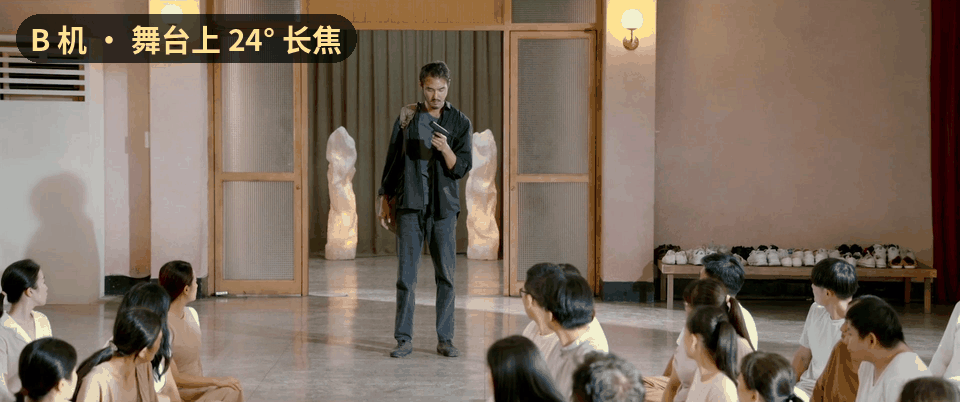

意外的发现：门口那组主角的镜头，是从舞台上用长焦隔着整个大厅拍的，所以人群被压得很扁。

### Step 5 · 推灯光

逐类写证据：

- 两侧大窗加纱帘，就是两只巨大的柔光箱，礼堂因此又亮又“圣洁”；
- 天花灯盘、壁灯、画像背光、发光的石雕，这些画内能看到的实用光，可信度高；
- 门洞后挂着黑幕，让主角从背景里“跳”出来。

看不到证据的灯，一律标“推测”。

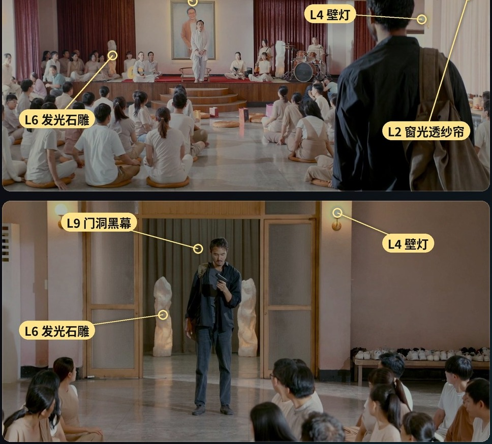

### Step 6 · 在 Blender 里搭现场

所有数据放在一个 `plan_data.json` 里：机位、镜头、主角走位、灯、人。Blender 构建脚本据此 1:1 搭出礼堂，摆进 25 台机（机身、视锥、三脚架或手持操作员）和 162 个群演。群演按座位批量生成，中间留出主角通道。

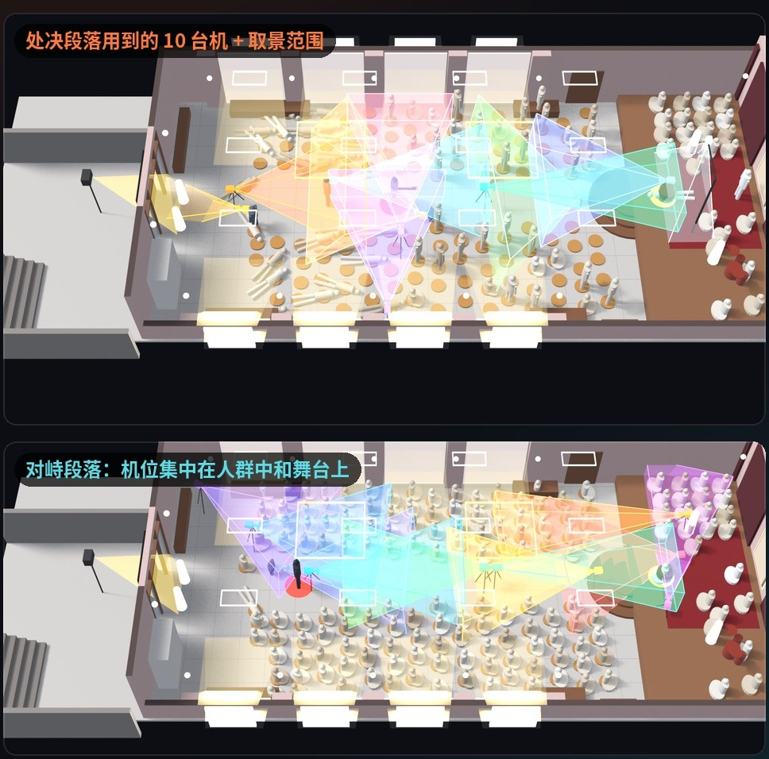

### Step 7 · 同机位“重拍”一遍

用算出的机位在 3D 里重新“拍”一遍，和原片并排对比。低可信度的手持近景对不上是正常的，交付时会写明。

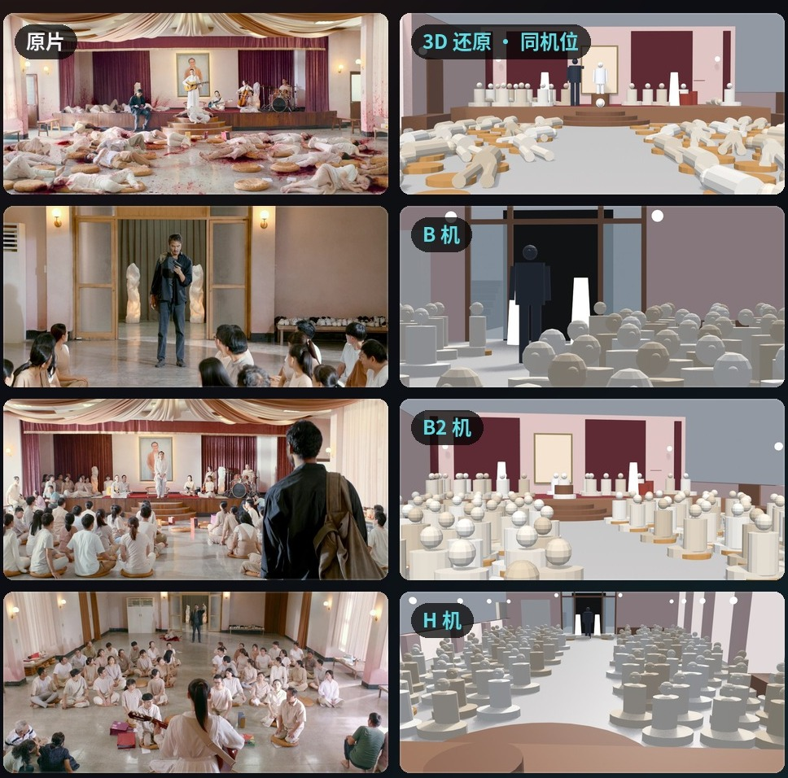

### Step 8 · 合成教学视频和方案图

每个镜头渲染一张俯视图，记下每台机、每个人物、每盏灯在画面上的锚点，再合成 1080×1560 的面板：上面是原片，中间是滚动的机位时间轴，下面是俯视现场和机位说明。

<table>
<tr>
<td width="45%">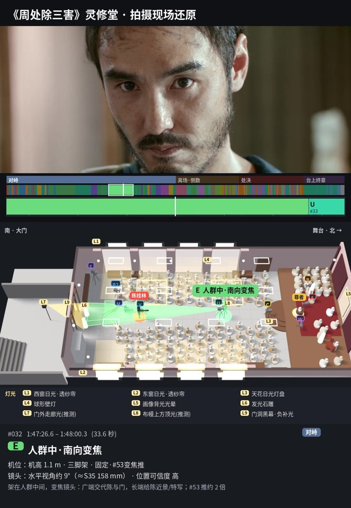</td>
<td width="55%">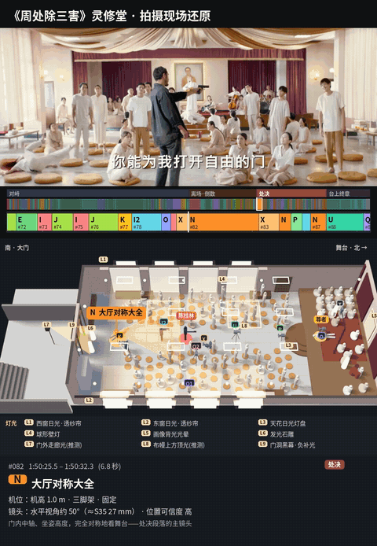</td>
</tr>
</table>

另外还会出一张总图：全部机位和灯光的俯视渲染，加上摄影机方案表和灯光方案表。

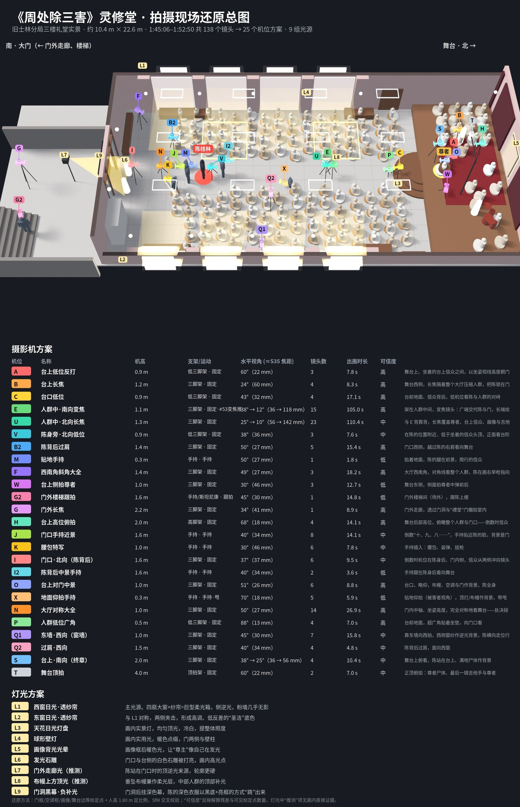

---

## 怎么使用这两个 skill

### 需要准备

- **Claude**：原项目是在 Claude 桌面 app 里做的。Claude 在云端跑计算，通过关联的电脑读片源、跑 ffmpeg，用 Blender MCP 操作本机的 Blender。
- **Blender** + **Blender MCP 插件**（例如开源的 [blender-mcp](https://github.com/ahujasid/blender-mcp)）：建模和渲染全部通过插件的 `execute_blender_code` 完成。人物网格可以选用插件的 Hyper3D Rodin 生成，素材可以选用 Poly Haven。
- **Python 库**：`opencv-python`、`numpy`、`scipy`、`Pillow`、`pycolmap`（SfM），长镜头还要 `onnxruntime`（YOLOX）、`mediapipe`，字幕识别用 `rapidocr-onnxruntime`。
- **ffmpeg**：要烧字幕的话需要带 libass。
- **片源**：你自己合法获得的影片文件。本仓库不提供任何片源。

### 安装

**在 Claude app 里**：把 skill 文件夹打成 zip（zip 的根目录就是这个文件夹），在 Customize → Skills 里上传并启用。详见官方说明：[Use custom skills](https://support.claude.com/en/articles/12512198-use-custom-skills)。

```bash
cd skills
zip -r film-set-reconstruction.zip film-set-reconstruction
zip -r multishot-scene-set-reconstruction.zip multishot-scene-set-reconstruction
```

**在 Claude Code 里**：把文件夹复制到 `~/.claude/skills/`（个人）或项目里的 `.claude/skills/`（项目）。详见 [Claude Code 文档](https://code.claude.com/docs/en/skills)。

```bash
cp -r skills/film-set-reconstruction skills/multishot-scene-set-reconstruction ~/.claude/skills/
```

### 怎么开口

给够上下文：片源在哪、精确到秒的起止时间码、想要什么样的呈现形式。比如：

```text
/film-set-reconstruction 还原《大事件》01:20.8–08:07.7 的开场长镜头。
片源在「电影资源」文件夹里。做成上面是拍摄现场（从摄影机身后看）、下面是原片的对照视频。
```

```text
/multishot-scene-set-reconstruction 还原《周处除三害》1:45:06–1:52:49 灵修堂这场戏。
把所有机位和灯光都还原出来，做成俯视图；成片切到哪个镜头，就亮哪台机。
```

接下来，AI 会先和你确认范围、版式和精度，重活开工前会先给计划和预计耗时。你要做的主要是审片：看同机位对照 PDF，按“第几页第几帧”指出不对的地方。

### 关于脚本

`scripts/` 里是两个项目实际跑过的代码。路径、时间码、房间尺寸、机位参数都是那部片子的，换片时要逐项改。建议先读 `SKILL.md`，做到某一步时再看对应的脚本。脚本索引：

- 长镜头：[`skills/film-set-reconstruction/scripts/README.md`](skills/film-set-reconstruction/scripts/README.md)
- 多镜头：[`skills/multishot-scene-set-reconstruction/README.md`](skills/multishot-scene-set-reconstruction/README.md)

---

## 仓库结构

```text
.
├── README.md
├── docs/images/                 # 本页配图
│   ├── long-take/
│   └── multishot/
└── skills/
    ├── film-set-reconstruction/             # 长镜头还原
    │   ├── SKILL.md                         #   skill 正文
    │   ├── references/                      #   每一步的命令与参数、运行环境、踩过的坑
    │   └── scripts/                         #   可以改着用的脚本 + reference/（《大事件》原样代码）
    └── multishot-scene-set-reconstruction/  # 多镜头群戏还原
        ├── SKILL.md                         #   skill 正文
        ├── README.md                        #   脚本索引
        └── scripts/                         #   02_geometry … 07_showcase，按流程分组
```

---

## 几点体会

- **给 AI 足够的上下文，它就能做出很有意思的东西。** 上下文 = 素材 + 目标 + 反馈：片源、精确到秒的时间码、想要的呈现形式，以及具体到“第几页第几帧”的意见。
- **它不只是听话。** 一开始想拆《花样年华》，它先泼了冷水：王家卫的方案是边拍边“长”出来的，倒推出来的东西其实是替他整理的，不适合当教材。算不准的地方，它会主动标“推测”。
- **经验可以沉淀。** 每个项目做完，都让它把方法和踩过的坑写成 skill，下次换一部电影，不用从头摸索。这个仓库里的两个 skill 就是这么来的。

看它从一堆像素里抠出尺寸、机位和光，很像看侦探破案。拉片以前只能靠经验和想象，现在可以“走进去看”。

如果你也有一场一直好奇“到底是怎么拍的”戏，不妨挑出来试试。

---

## 声明

- 文中电影画面的版权归原片方所有，仅作学习交流和评论使用。仓库里不包含任何片源或完整片段。
- 机位、走位与灯光均为根据成片做的推断，不代表剧组的真实方案；可信度在各自的方案表里有标注。
- 字幕相关脚本不包含影片对白的译文，也不转写歌词。

---

## English summary

**Reconstructing a film's shooting set from the finished film alone, with AI.** No storyboards, no set photos: just the footage. Claude works out where every camera stood, how it moved, where the actors walked and where the light came from, rebuilds the set in Blender (through a Blender MCP add-on), and re-shoots it from the same camera positions to check against the original frame by frame.

This repo contains two reusable Claude skills (documentation in Chinese):

- **[`film-set-reconstruction`](skills/film-set-reconstruction/SKILL.md): for long takes.** One continuous camera move, reconstructed as a per-frame camera path. Uses SfM, vanishing points and known object sizes for scale, plus hand-solved keyframes where SfM breaks. People are detected, tracked, identified and placed on the ground. Example: the opening long take of *Breaking News* (Johnnie To, 2004), 6′47″, 9,768 frames.
- **[`multishot-scene-set-reconstruction`](skills/multishot-scene-set-reconstruction/SKILL.md): for edited multi-camera scenes in one space.** Detect the cuts (muzzle flashes filtered out), group shots into camera setups, solve the room and every camera with a parametric bundle adjustment plus per-setup PnP, and infer the lighting with stated evidence and confidence. Output is a top-down set plan synced to the film's timeline. Example: the cult-hall scene in *The Pig, the Snake and the Pigeon* (2023): 138 shots, 25 camera setups, 9 light sources.

**Which one to use:** count the cuts. A single long, moving shot calls for the long-take skill. Many cuts within one fixed space call for the multishot skill.

Film stills are copyright of their owners and are used here for study and commentary. All camera and lighting plans are inferences from the finished film, not the productions' actual plans.
